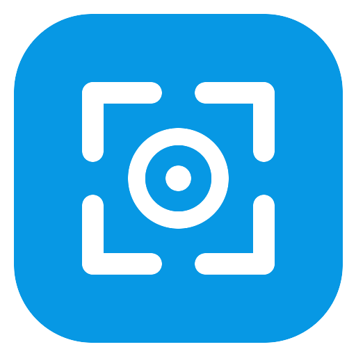

# CaptureClean

Capturador de pantalla para Windows: selecciona, anota, copia o guarda. Es nativo y ligero, sin publicidad y sin ningún código de red: nada sale de tu equipo.

**[⬇ Descargar el instalador](https://github.com/mtandazo35/captureclean/releases/latest)**

## Instalar

Descarga y ejecuta `CaptureClean-Setup-<versión>.exe`. Requiere Windows 10 versión 1703 o posterior (incluido Windows 11) de 64 bits, y no necesita permisos de administrador. Si ya lo tienes instalado, se actualiza en la misma carpeta y conserva tus preferencias y tus capturas.

CaptureClean queda en la bandeja del sistema, junto al reloj. Si no ves el icono, búscalo en la flecha **^** de iconos ocultos.

> **Aviso de Windows:** el instalador aún no está firmado, así que SmartScreen puede mostrar "Windows protegió su PC". Si confías en la descarga, pulsa *Más información* y luego *Ejecutar de todas formas*. Para comprobar que el archivo no se alteró, compara el resultado de `certutil -hashfile CaptureClean-Setup-<versión>.exe SHA256` con el archivo `.sha256` publicado junto al instalador.

## Capturar

| Qué | Cómo |
|---|---|
| Un área | `Impr Pant`, `Ctrl+Mayús+S`, doble clic en el icono de la bandeja o el acceso directo |
| Una ventana o un monitor | Inicia una captura de área y haz clic sobre ella, sin arrastrar |
| La ventana activa | `Alt+Impr Pant` o el menú de la bandeja |
| La última zona otra vez | `Mayús+Impr Pant` o el menú de la bandeja |
| Todo el escritorio | El menú de la bandeja, o `Ctrl+A` durante la captura |

> **`Impr Pant` en Windows 11:** si se abre la herramienta Recortes en su lugar, desactiva *Usar el botón Impr Pant para abrir la captura de pantalla* en *Configuración → Accesibilidad → Teclado* y reinicia CaptureClean. Mientras tanto puedes usar `Ctrl+Mayús+S`.

## Anotar

Al terminar la selección aparecen las barras de herramientas:

- **Dibujo:** lápiz, línea, flecha, rectángulo, elipse y resaltador.
- **Texto:** se escribe directamente sobre la captura, con negrita, cursiva y subrayado en la mini barra **B I U** junto al botón Texto. El doble clic vuelve a editarlo.
- **Pixelar:** tapa datos sensibles como contraseñas, direcciones o nombres.
- **Numerar:** añade círculos numerados para marcar pasos. Puede reiniciar la cuenta desde *Tamaño y grosor*.
- **Colores rápidos y Tamaño y grosor:** ajustan la herramienta activa. El color también cambia el del objeto seleccionado.
- **Seleccionar y mover:** mueve o borra cualquier objeto, y también mueve la selección.

La selección se redimensiona con sus tiradores en cualquier momento.

## Copiar y guardar

- **Copiar** deja la imagen en el portapapeles, lista para pegar en cualquier aplicación.
- **Guardar** crea un archivo PNG o JPEG con un nombre que incluye la fecha y la hora.
- **Guardado automático:** se activa en Preferencias. Guarda sin preguntar en la carpeta que elijas, tanto al copiar como al guardar.

## Atajos de teclado

| Durante la captura | |
|---|---|
| `Ctrl+C` | Copiar y cerrar |
| `Ctrl+S` | Guardar |
| `Ctrl+Z` / `Ctrl+Y` | Deshacer / Rehacer |
| `Ctrl+A` | Seleccionar todo el escritorio |
| `Supr` | Borrar el objeto seleccionado |
| Flechas | Mover el objeto seleccionado o la selección (con `Mayús`, de 10 en 10 píxeles) |
| `Esc` o `Ctrl+X` | Cerrar |
| Mantener `Ctrl` al soltar la selección | Copiar directamente |
| Clic derecho | Cancelar la selección o el trazo en curso |

| Al escribir texto | |
|---|---|
| `Intro` | Confirmar |
| `Mayús+Intro` | Nueva línea |
| `Esc` | Cancelar |
| `Ctrl+V` | Pegar |
| `Ctrl+B` / `Ctrl+I` / `Ctrl+U` | Negrita / Cursiva / Subrayado |

## Preferencias

Se abren con clic derecho en el icono de la bandeja → *Preferencias…*: inicio con Windows, lupa durante la selección, confirmación al cerrar con `Esc`, tamaños y formato predeterminados, y guardado automático.

## Privacidad

This program will not transfer any information to other networked systems unless specifically requested.

CaptureClean no tiene código de red. Tus capturas solo van donde tú las copies o las guardes, y las preferencias se guardan en tu equipo, en `HKCU\Software\CaptureClean`.

## Desinstalar

Desde *Configuración → Aplicaciones*. Te preguntará si también quieres borrar tus preferencias. Las capturas guardadas no se borran nunca.

## Instalación desatendida

| Parámetro | Efecto |
|---|---|
| `/S` | Instala en silencio |
| `/ABRIR` | Abre la aplicación al terminar una instalación silenciosa |
| `/D=C:\carpeta` | Elige la carpeta, si no hay otra instalación; va siempre al final y sin comillas |

Para desinstalar en silencio: `Uninstall.exe /S`, que conserva las preferencias.

## Desarrollo

Está escrito en C++17 y GDI+. Se compila desde Linux con `mingw-w64` y `nsis`, y el resultado queda en `dist/`:

```sh
bash build.sh
```

| Archivo | Contenido |
|---|---|
| `src/overlay.cpp` | Ventana de captura: selección, objetos, dibujo y exportación |
| `src/main.cpp` | Bandeja, atajos e instancia única |
| `src/preferences.cpp`, `src/settings.cpp` | Ventana de preferencias y registro |
| `src/imageio.cpp` | Portapapeles, PNG y JPEG |
| `src/logic.h` | Lógica pura, sin ventanas |
| `tests/unit.cpp` | Pruebas de `logic.h` |
| `tests/ui_test.cpp` | Prueba de extremo a extremo: maneja la aplicación real con ratón y teclado |

Las pruebas se ejecutan en GitHub Actions en cada `push`. **No ejecutes `ui_test.exe` en un equipo de uso diario**, porque cambia las preferencias y el portapapeles.

### Publicar una versión

El instalador oficial sale siempre de GitHub Actions, no de un equipo personal:

1. Cambia la versión en `src/version.h`, el único sitio donde se define, y añade su sección en `CHANGELOG.md`.
2. Haz commit y sube una etiqueta con esa versión: `git tag vX.Y.Z` y `git push origin main vX.Y.Z`.

La etiqueta compila, pasa las pruebas y publica la versión con el instalador y su SHA256. Si algo falla, o si la etiqueta no coincide con `src/version.h`, no se publica nada.

## Política de firma de código

**Estado:** las versiones publicadas todavía no están firmadas. La solicitud de firma a SignPath Foundation está en preparación.

Una vez aprobada, se aplicará lo siguiente:

- Free code signing provided by [SignPath.io](https://signpath.io), certificate by [SignPath Foundation](https://signpath.org).
- Committers and reviewers: [mtandazo35](https://github.com/mtandazo35)
- Approvers: [mtandazo35](https://github.com/mtandazo35)

## Cambios y licencia

- Historial de versiones: [CHANGELOG.md](CHANGELOG.md).
- Licencia: [MIT](LICENSE).
